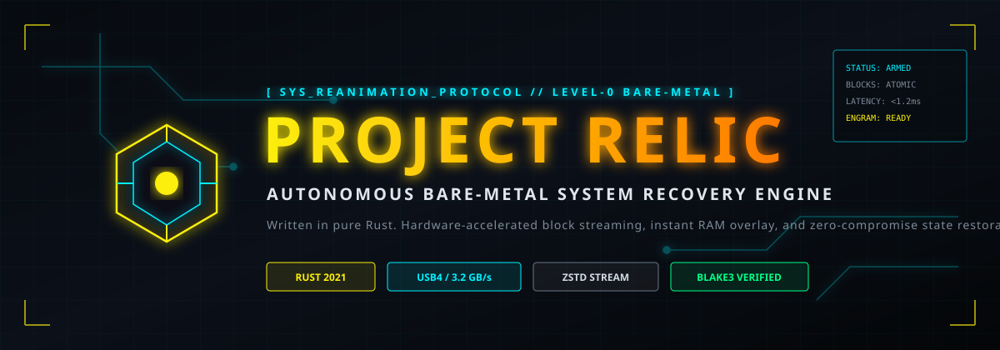

<!-- ================= HEADER BANNER ================= -->
<p align="center">
  
</p>

<!-- ================= BADGES ROW ================= -->
<p align="center">
  <a href="https://github.com/AceRevo/relic/releases"></a>
  
  
  
  
  
</p>

<!-- ================= HUD NAVIGATION BAR ================= -->
<p align="center">
  <a href="#-descripción-general--overview"><code>🌐 VISIÓN</code></a> &nbsp;•&nbsp;
  <a href="#-características-principales"><code>⚡ CAPACIDADES</code></a> &nbsp;•&nbsp;
  <a href="#-arquitectura-y-protocolo-de-bloques"><code>🏗️ ARQUITECTURA</code></a> &nbsp;•&nbsp;
  <a href="#-hardware-recomendado-bom"><code>🔌 HARDWARE</code></a> &nbsp;•&nbsp;
  <a href="#-demostración-de-interfaz-tui"><code>🖥️ TUI HUD</code></a> &nbsp;•&nbsp;
  <a href="#-referencia-de-comandos-cli"><code>🛠️ USO CLI</code></a> &nbsp;•&nbsp;
  <a href="#-compilación-y-ejecución"><code>📦 COMPILACIÓN</code></a>
</p>

---

# ⚡ PROJECT RELIC
> **Autonomous Bare-Metal Disaster Recovery and System Reanimation Engine in Rust.**  
> *Motor de recuperación de desastres a nivel de bloques y reanimación autónoma de sistemas de alto rendimiento.*

---

## 🌐 Descripción General / Overview

Cuando un sistema informático sufre un colapso catastrófico —corrupción crítica de kernel, bucles de pantalla azul (BSOD), colapso de particiones GPT o secuestro por ransomware— los métodos tradicionales de recuperación fallan por lentitud o fragilidad:
- **Sincronización archivo por archivo (como `rsync`):** Sufre una penalización masiva por traversal de inodos y metadatos cuando existen millones de archivos pequeños.
- **Herramientas de clonación convencionales:** Carecen de detección de bloques dispersos (sparse) en tiempo real, carecen de interfaz moderna de telemetría y saturan buses lentos.
- **Tiempos de inactividad inaceptables:** Restaurar 1 TB de datos corporativos o entornos de desarrollo suele demorar entre 2 y 6 horas.

**PROJECT RELIC** transforma este paradigma mediante una unidad NVMe externa de ultra-alta velocidad conectada por USB4 / Thunderbolt 4 (40 Gbps):
1. **Arranque en memoria RAM (<2 segundos):** Un entorno mínimo UEFI ejecuta el binario de RELIC directamente como PID 1.
2. **Streaming a nivel de bloques puros:** Lee la geometría raw del disco físico, descarta sectores vacíos sin costo de compresión y transmite a través de un pipeline multi-hilo Zstandard.
3. **Validación criptográfica BLAKE3:** Cada bloque de 4 MB a 64 MB se valida con aceleración vectorial por hardware (AVX-512 / NEON) a más de 6 GB/s por núcleo.
4. **Restauración en sub-minuto:** Capacidad de reanimar sistemas operativos completos a tasas sostenidas de **2.0 a 3.2 GB/s**.

---

## ⚡ Características Principales

- **🚀 Motor de Restauración Bare-Metal:** Opera directamente sobre nodos de bloques (`/dev/nvmeXn1`, `\\.\PhysicalDriveX`), sin depender de capas de archivos intermedias.
- **🗜️ Compresión Zstandard Multi-Hilo:** Algoritmo Zstandard LZ77 de baja latencia con niveles dinámicos optimizados para saturar enlaces PCIe Gen4.
- **🧠 Detección Inteligente de Bloques Dispersos (Sparse Streaming):** Analiza bloques nulos (`0x00`) y los señaliza en el encabezado del contenedor sin emitir bytes redundantes, preservando la alineación exacta de sectores al restaurar.
- **🛡️ Verificación Criptográfica por Bloques (BLAKE3):** Cada fragmento del contenedor cuenta con un checksum BLAKE3 integrado en el framing binario, garantizando tolerancia cero a la corrupción de bits.
- **🖥️ Cyberpunk Terminal UI (Ratatui + Crossterm):** Interfaz interactiva de alta fidelidad con monitoreo de telemetría, velocímetro en tiempo real, calibración de sectores y barras de progreso fluidas.
- **🔍 Inspector de Topología de Almacenamiento:** Detección automática de discos físicos, particiones, capacidades y estados de montaje vía `sysinfo`.
- **📦 Formato de Contenedor Binario RELIC01:** Especificación abierta y ultra-compacta diseñada para streaming sin overhead.

---

## 🏗️ Arquitectura y Protocolo de Bloques

```
+---------------------------------------------------------------------------------+
|                                 CICLO DE VIDA RELIC                             |
+---------------------------------------------------------------------------------+
|  [ DISCO ANFITRIÓN ]                                                            |
|       |                                                                         |
|       v                                                                         |
|  [ LECTURA DE GEOMETRÍA GPT/MBR & SECTORES RAW ]                                |
|       |                                                                         |
|       +--> [ DETECTOR SPARSE ] ---> ¿Bloque nulo (0x00)?                        |
|                 |                                    |                          |
|                 | NO (Activo)                        | SÍ (Vacío)               |
|                 v                                    v                          |
|         [ ZSTD COMPRESSOR ]                  [ CHUNK HEADER: SPARSE=1 ]         |
|                 |                                    |                          |
|                 v                                    |                          |
|         [ BLAKE3 TREE HASH ]                         | (0 bytes payload)        |
|                 |                                    |                          |
|                 +-----------------+------------------+                          |
|                                   |                                             |
|                                   v                                             |
|                   [ CONTENEDOR BINARIO (.zst / .relic) ]                        |
|                                   |                                             |
|       =================== FASE DE RESTAURACIÓN ===================              |
|                                   |                                             |
|                                   v                                             |
|                   [ VERIFICACIÓN BLAKE3 EN STREAM ]                             |
|                                   |                                             |
|                                   v                                             |
|                   [ ESCRITURA DIRECTA NVMe / USB4 (3.2 GB/s) ]                  |
|                                   |                                             |
|                                   v                                             |
|                   [ HOST REANIMADO Y OPERATIVO ]                                |
+---------------------------------------------------------------------------------+
```

### Especificación del Contenedor `RELIC01`

| Campo | Tipo | Tamaño | Descripción |
| :--- | :--- | :--- | :--- |
| **Magic** | `[u8; 8]` | 8 bytes | Identificador `b"RELIC01\0"` |
| **Block Size** | `u32` (Little Endian) | 4 bytes | Tamaño de bloque configurado (ej: 4 MB = 4,194,304 bytes) |
| **Total Source Bytes** | `u64` (Little Endian) | 8 bytes | Tamaño total del volumen origen en bytes |
| **Chunk Index** | `u64` (Little Endian) | 8 bytes | Índice secuencial del bloque |
| **Is Sparse** | `u8` | 1 byte | `1` si el bloque está vacío (ignora payload), `0` si tiene datos |
| **Uncompressed Size** | `u32` (Little Endian) | 4 bytes | Longitud del bloque original |
| **Compressed Size** | `u32` (Little Endian) | 4 bytes | Longitud de la carga comprimida |
| **BLAKE3 Hash** | `[u8; 32]` | 32 bytes | Hash de integridad del bloque sin comprimir |
| **Payload** | `[u8; Compressed Size]` | Variable | Datos comprimidos mediante Zstandard |

---

## 🔌 Hardware Recomendado (BOM)

Para alcanzar el rendimiento máximo del motor de reanimación, se recomienda la siguiente configuración física de hardware:

| Componente | Especificación Técnica | Modelos Recomendados |
| :--- | :--- | :--- |
| **Engram Vault (SSD)** | M.2 2280 NVMe PCIe 4.0 x4 (3D TLC con caché DRAM dedicada) | Samsung 990 PRO / Crucial T500 / WD_BLACK SN850X |
| **Carrier Enclosure** | Carcasa de aluminio CNC con controladora USB4 40 Gbps / Thunderbolt | Acasis TBU405 / Yottamaster ASM2464PD / Intel JHL7440 |
| **Write-Blocker (Forense)** | Dispositivo de emulación y bloqueo de escritura por hardware | IODD 2531 / IODD Mini OLED |

> Consulta la guía completa de especificaciones en [docs/HARDWARE_SPECS.md](docs/HARDWARE_SPECS.md) y la arquitectura detallada en [docs/ARCHITECTURE.md](docs/ARCHITECTURE.md).

---

## 🖥️ Demostración de Interfaz TUI

Al ejecutar `relic` sin argumentos, se inicializa la consola interactiva Cyberpunk construida en `Ratatui`:

```text
┌─ [ PROJECT RELIC // BARE-METAL SYSTEM RECOVERY ENGINE ] ──────────────────────┐
│ STATUS: ARMED // HOST LINK ESTABLISHED // NVMe STORAGE READY                  │
└───────────────────────────────────────────────────────────────────────────────┘
┌─ TELEMETRY & SYSTEM STATE ────────────────────────────────────────────────────┐
│ TARGET DISK:      /dev/nvme0n1 [Samsung 990 PRO 2TB]                          │
│ IMAGE CONTAINER:  RELIC_SNAPSHOT_SYS.relic (84.2 GB)                          │
│ ACTIVE STREAM:    Zstandard LZ77 (Multi-threaded, Block size: 4 MB)           │
│ INTEGRITY ENGINE: BLAKE3 (AVX-512 Hardware Accelerated)                       │
│ ESTIMATED TIME:   34 seconds remaining @ 2.45 GB/s                            │
└───────────────────────────────────────────────────────────────────────────────┘
┌─ RESTORATION PROGRESS ────────────────────────────────────────────────────────┐
│ █████████████████████████████████████████████████████░░░░░░░░░░░░░░ 78%       │
└───────────────────────────────────────────────────────────────────────────────┘
  Press [Q] or [Esc] to exit | [SPACE] to pause/resume | [R] to re-scan hardware
```

---

## 🛠️ Referencia de Comandos CLI

El binario compilado ofrece una interfaz de línea de comandos intuitiva estructurada mediante `clap`:

### 1. Captura de Imagen (Snapshot / Engram)
Genera una imagen comprimida a alta velocidad de un disco físico o volumen:
```bash
# Captura con tamaño de bloque predeterminado (4 MB) y compresión balanceada
relic capture --source /dev/nvme0n1 --output /mnt/vault/system_engram.relic

# Captura con bloques de 16 MB y compresión ultrarrápida (nivel 1)
relic capture --source /dev/nvme0n1 --output /mnt/vault/system.relic --block-size-mb 16 --compression-level 1
```

### 2. Restauración Bare-Metal (Reanimation)
Sobrescribe el disco objetivo restaurando el sistema completo:
```bash
# Restauración con advertencia de seguridad interactiva
relic restore --image /mnt/vault/system_engram.relic --target /dev/nvme0n1

# Restauración forzada directa (automatización / scripts PID 1)
relic restore --image /mnt/vault/system_engram.relic --target /dev/nvme0n1 --force
```

### 3. Verificación de Integridad Criptográfica (Verify)
Comprueba el 100% de los hashes BLAKE3 de cada bloque en el contenedor:
```bash
relic verify --image /mnt/vault/system_engram.relic
```

### 4. Inspección de Dispositivos (Inspect)
Lista las unidades de almacenamiento conectadas, puntos de montaje y capacidades:
```bash
relic inspect --detailed
```

---

## 📦 Compilación y Ejecución

### Requisitos Previos
- **Rust Toolchain:** Rust 1.75+ (Cargo + `rustc`)
- **Bibliotecas C:** `libzstd` (o compilación estática integrada por el crate `zstd`)
- **Sistemas compatibles:** Linux (x86_64, aarch64) y Windows (x86_64)

### Compilación en Modo Release Optimizado
```bash
# Clonar el repositorio
git clone https://github.com/AceRevo/relic.git
cd relic

# Compilar con optimizaciones LTO agresivas
cargo build --release

# El binario ultra-optimizado estará en:
# target/release/relic (Linux)
# target/release/relic.exe (Windows)
```

---

## 📄 Licencia

Este proyecto está distribuido bajo las licencias duales **MIT** y **Apache-2.0**. Puedes consultar los términos legales correspondientes en los archivos de licencia.

---

<p align="center">
  
  <br>
  <sub>Desarrollado con dedicación para la comunidad de alto rendimiento y resiliencia de sistemas por <b>AceRevo</b>.</sub>
</p>
